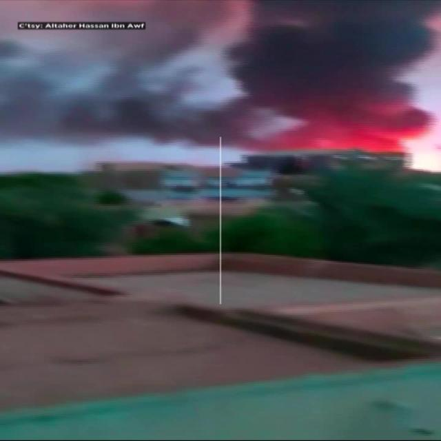

# Fire and Smoke Detection with YOLO

## Clone or update the project

Clone the GitHub repository once:

```bash
git clone https://github.com/mahmoudrabea01/fire_smoke_detection.git
cd fire_smoke_detection
```

To get the latest changes in an existing clone, run this from the project directory:

```bash
git pull
```



*Sample image from the Roboflow fire-and-smoke dataset; see [Attribution](#attribution).*

## About

This project explores object detection for two classes: **fire** and **smoke**. It uses Ultralytics YOLO26s, a small YOLO model, and includes notebooks for preparing/checking the dataset, training and evaluating a model, and running video inference.

The Roboflow dataset contains 5,596 labeled images split into train, validation, and test sets. The raw dataset is not included in the repository; download it as described below.

## Setup

The project requires Python 3.12 or newer. From the project directory:

```bash
python -m pip install uv
uv sync
```

In PowerShell, activate the environment with:

```powershell
.\.venv\Scripts\Activate.ps1
```

The local dataset/inference notebook reads the Roboflow API key from `.env`. Create it from the example and add your key:

```powershell
Copy-Item .env.example .env
```

Never commit `.env` or paste a real API key into a notebook. Open `notebooks/fire_smoke_detection.ipynb` in VS Code, run its dataset download cells, and it will save the dataset under `data/raw/fire_smoke/`. The `data/raw/` directory is intentionally ignored by Git.

## Notebooks

- [`notebooks/YOLO_fire_smoke_project.ipynb`](notebooks/YOLO_fire_smoke_project.ipynb) is the training and evaluation walkthrough. It downloads the dataset from Roboflow, trains YOLO26s for 50 epochs at an image size of 640, validates the model, and evaluates the test split. Its paths and GPU settings are written for Google Colab; configure your Roboflow key privately before downloading.
- [`notebooks/fire_smoke_detection.ipynb`](notebooks/fire_smoke_detection.ipynb) checks the dataset and runs video inference with a local checkpoint. The example expects a checkpoint at `models/fire_smoke_yolo26s.pt` and a video under `outputs/videos/`. Checkpoints and output videos are not included in the repository.

Training generates `best.pt` and `last.pt` in the YOLO run's `weights` directory (typically under `runs/`). Keep these files locally or store them separately; they are ignored by Git.

## YOLO detection and training

### What detection means in YOLO

Object detection means finding **where** objects are and **what** they are. For each detected fire or smoke region, YOLO predicts a bounding box, a class label, and a confidence score. Unlike image classification, detection can locate multiple objects in one image.

### Why start with a small YOLO model?

The small (`s`) model is a practical baseline: it needs less memory and compute and usually trains and predicts faster than larger variants. This makes experiments easier to run. Larger models may improve accuracy, but can require more time and hardware.

### What epochs mean

An epoch is one complete pass through the training images. The training notebook uses 50 epochs, so the model can learn from the training set repeatedly. More epochs are not automatically better; training too long can overfit, so validation results help decide which checkpoint to keep.

### What image size means

`imgsz=640` sets the target image size used by the model during training and evaluation (commonly 640 by 640 pixels). YOLO resizes images to fit this size. Larger sizes can preserve more detail, but use more memory and computation; smaller sizes are faster but may lose details, especially for small objects.

### What happens during model training

The training process reads images and their labeled bounding boxes, makes predictions, compares those predictions with the labels, and calculates losses for localization and classification. It uses those losses to update the model's weights. This repeats over batches throughout each epoch. After epochs, YOLO checks performance on the validation set and saves checkpoints. The separate test set is for a final evaluation, not for choosing model weights.

## Model files and evaluation metrics

### `best.pt` and `last.pt`

- **`best.pt`** is the checkpoint YOLO selected as the best-performing one during training, based on its validation fitness. It is usually the starting point for inference and final testing.
- **`last.pt`** is the checkpoint saved at the final completed epoch. It is useful for resuming training, even if an earlier checkpoint performed better.

### Precision

Precision answers: **Of the objects the model predicted, how many were correct?** It is `true positives / (true positives + false positives)`. Higher precision means fewer false alarms.

### Recall

Recall answers: **Of the actual labeled objects, how many did the model find?** It is `true positives / (true positives + false negatives)`. Higher recall means fewer missed fires or smoke regions.

### mAP

Mean Average Precision (mAP) summarizes detection quality across classes. Average Precision (AP) combines precision and recall across confidence thresholds; mAP averages AP across the classes, here fire and smoke. Object detections count as correct only when their predicted boxes overlap the labeled boxes enough, measured with Intersection over Union (IoU).

YOLO commonly reports **mAP@0.5** (IoU threshold 0.50) and **mAP@0.5:0.95** (averaged across IoU thresholds from 0.50 to 0.95). The latter is stricter about box placement. Higher values indicate better overall detection, but precision, recall, and per-class results should also be considered.

## Attribution

The sample image and dataset are from [fire and smoke detector, version 14 on Roboflow Universe](https://universe.roboflow.com/gfo-fc1de/fire-and-smoke-detector-yykya/dataset/14), provided under the [Creative Commons Attribution 4.0 International license](https://creativecommons.org/licenses/by/4.0/).
